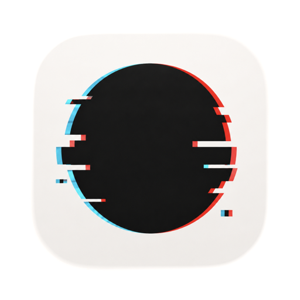

<p align="center">
  
</p>

<h1 align="center">Glitch Spot</h1>

<p align="center">
  <em>Press a hotkey, draw on your screen, and hand the result to your AI coding agent — or a teammate.</em>
</p>

Glitch Spot is a macOS menu-bar tool for visual feedback during development. Trigger an
overlay with a global hotkey, mark up anything on screen with rectangles and notes, and the
result becomes a structured snapshot your AI coding agent can read directly.

## Features

- **Hotkey overlay, two modes** — a live transparent overlay (`⌃⌥⌘G`) or a frozen
  screenshot you can mark up (`⌃⌥⌘H`), plus a per-window picker (`⌃⌥⌘J`).
- **Annotate fast** — drag rectangles, attach inline notes, undo, then save (`⌘⇧↩`) or
  discard.
- **Agent-ready snapshots** — every annotation becomes structured JSON (copied to the
  clipboard) plus an annotated PNG. A local MCP server on `127.0.0.1:7820` lets AI coding
  agents pull the latest snapshot — Claude Code does this via the `/glitch-spot` skill.
- **Share in a click** — publish a snapshot behind a short-lived link via cloudflared,
  ngrok, or Tailscale Funnel.
- **Stays out of the way** — runs in the menu bar, with no Dock icon or app window.
- **Embeddable** — `@glitch-spot/electron` brings the same overlay into Electron apps.

## Install

Builds are **signed but not notarized** and **Apple Silicon only** (arm64), so macOS shows a
one-time *"Apple could not verify…"* prompt on first launch.

1. Download `Glitch-Spot_<version>_aarch64.zip` from the
   [latest release](https://github.com/dmakarenko/glitch-spot/releases/latest).
2. Double-click to unzip, then drag **Glitch Spot** to **Applications**.
3. Clear the one-time prompt — fastest via Terminal:

   ```
   xattr -dr com.apple.quarantine "/Applications/Glitch Spot.app"
   open "/Applications/Glitch Spot.app"
   ```

   Or open **System Settings → Privacy & Security** and click **Open Anyway**.

See **[docs/INSTALL.md](docs/INSTALL.md)** for the full walkthrough with screenshots,
including granting Screen Recording permission.

The app appears in the menu bar — there is no Dock icon or window.

## Development

```bash
PATH="$HOME/.cargo/bin:$PATH" npm run tauri -- dev
```

Stack: Tauri v2 (Rust) + React/TypeScript (Vite), inline styles, Vitest. See `CLAUDE.md`
and `DESIGN.md` for conventions.

## Releases

Built and published locally (no CI). From a clean `main`:

```bash
npm run release -- patch        # or minor | major | an explicit X.Y.Z
npm run release -- patch --dry-run   # build the app, change nothing in git/GitHub
```

This bumps the version across `package.json`, `package-lock.json`,
`src-tauri/tauri.conf.json`, `src-tauri/Cargo.toml`, and `src-tauri/Cargo.lock`; commits and
tags `vX.Y.Z`; builds a signed arm64 `.zip`; pushes; and creates the GitHub Release with
auto-generated notes.

If a release fails **before** the commit (e.g. the build errors), the version files are
restored automatically — just re-run. If it fails **after** the tag is created, delete the
tag (`git tag -d vX.Y.Z`, plus `git push origin :vX.Y.Z` if pushed) and re-run, or finish
the push / `gh release create` by hand.
