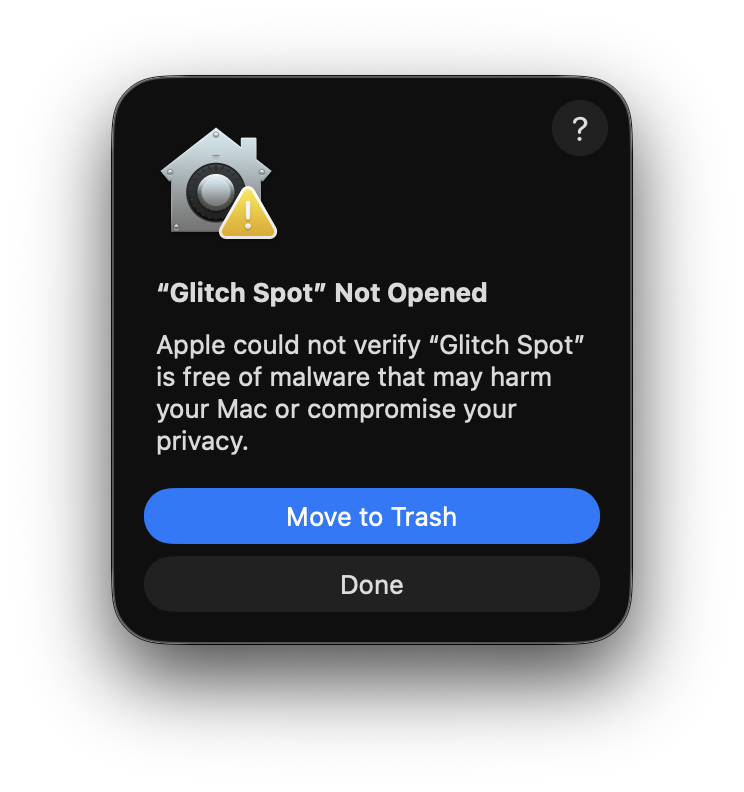
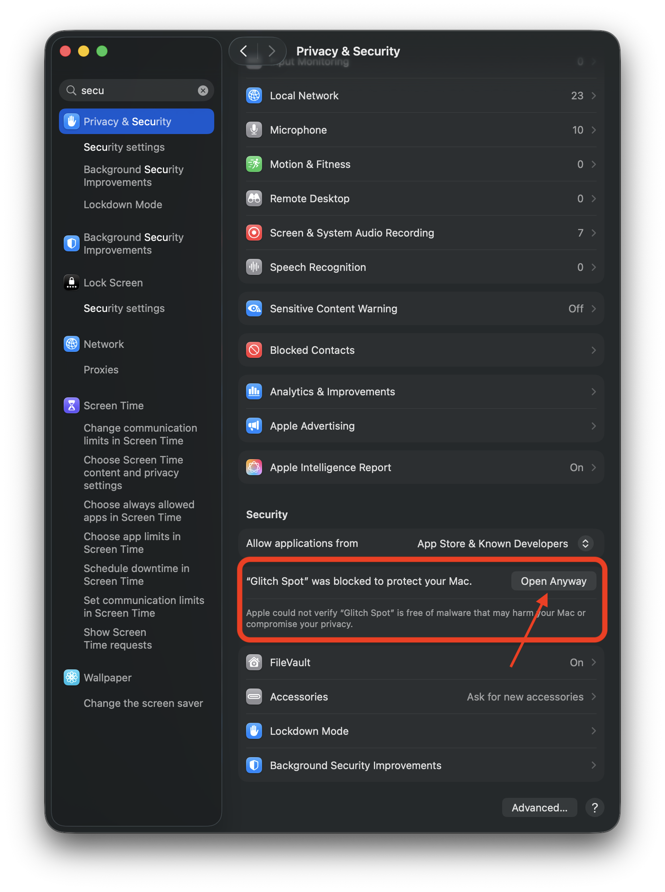
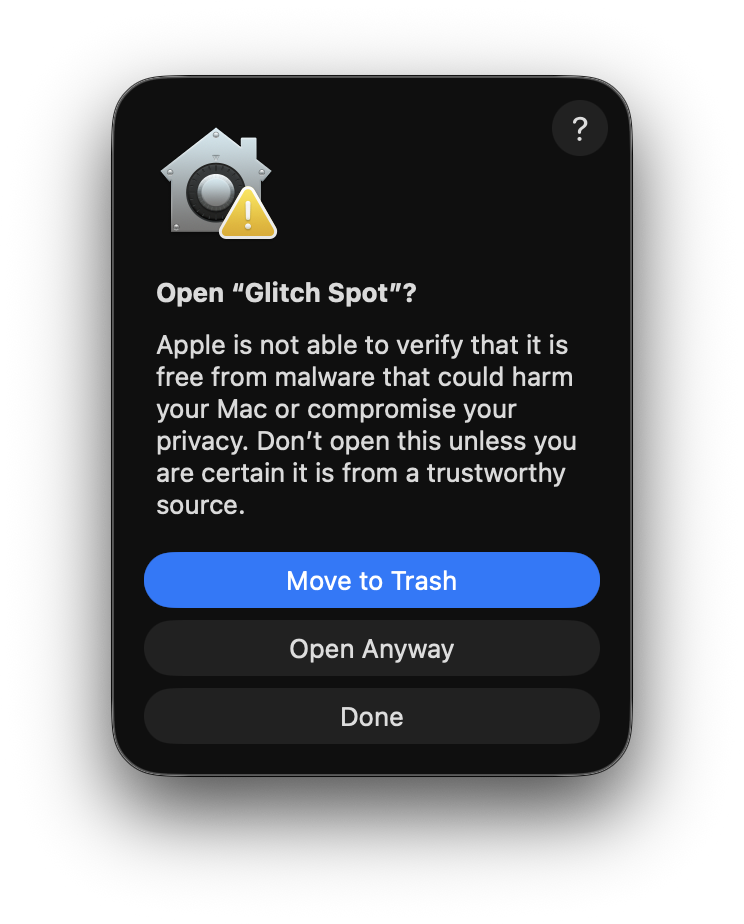

# Installing Glitch Spot

Glitch Spot is a macOS menu-bar tool. This guide walks through installing a downloaded
release from start to finish, including the one-time security prompt macOS shows.

**Requirements**

- A Mac with **Apple Silicon** (M1 or newer). The build is arm64-only; Intel Macs are not supported.
- macOS 14 (Sonoma) or newer.

## Is this safe? Why does macOS warn me?

The app is **code-signed but not notarized by Apple**. Notarization requires a paid Apple
Developer account; this build skips it. The practical effect is that on first launch macOS
shows a prompt like *"Apple could not verify 'Glitch Spot' is free of malware…"*.

This is expected and the app is safe to open. You clear the prompt **once**, and macOS
remembers your choice for every future launch.

---

## 1. Download the release

Open the [latest release](https://github.com/dmakarenko/glitch-spot/releases/latest) and
download the `Glitch-Spot_<version>_aarch64.zip` asset (for example
`Glitch-Spot_0.6.0_aarch64.zip`).

> 📸 **Screenshot:** the GitHub Releases page for the latest version, with the
> `Glitch-Spot_…_aarch64.zip` asset under **Assets** highlighted.


## 2. Unzip it

Double-click the downloaded `.zip` in your Downloads folder. macOS expands it into
**Glitch Spot.app**.

> 📸 **Screenshot:** Finder showing **Glitch Spot.app** next to the downloaded `.zip` in
> the Downloads folder.


## 3. Move it to Applications

Drag **Glitch Spot.app** into your **Applications** folder. Running it straight from
Downloads can misbehave, so move it first.

> 📸 **Screenshot:** dragging **Glitch Spot.app** from Downloads into the **Applications**
> folder in Finder.


## 4. Open it for the first time

Double-click **Glitch Spot** in Applications. macOS blocks it with the
*"Apple could not verify…"* prompt.

> 📸 **Screenshot:** the macOS *"Apple could not verify 'Glitch Spot' is free of malware…"*
> dialog, showing the **Done** and **Move to Bin** buttons.



Get past this one-time prompt with **either** option below.

### Option A — Terminal (fastest)

Open **Terminal** and run:

```
xattr -dr com.apple.quarantine "/Applications/Glitch Spot.app"
open "/Applications/Glitch Spot.app"
```

The first line removes the download quarantine flag; the second launches the app. No further
prompt appears.

### Option B — System Settings

1. In the prompt, click **Done** — **not** "Move to Bin".
2. Open **System Settings → Privacy & Security**.
3. Scroll down to the **Security** section. You'll see a line saying *"Glitch Spot" was
   blocked…* with an **Open Anyway** button. Click it.

   > 📸 **Screenshot:** **System Settings → Privacy & Security**, scrolled to the
   > **Security** section, with the *"Glitch Spot" was blocked* row and the **Open Anyway**
   > button visible.

   

4. macOS asks one more time to confirm — click **Open Anyway** (you may need to authenticate
   with Touch ID or your password).

   > 📸 **Screenshot:** the final confirmation dialog with the **Open Anyway** button.

   

## 5. Grant Screen Recording permission

Glitch Spot captures your screen, so macOS asks for **Screen Recording** permission the
first time you trigger a capture. Until you grant it, captures come back blank or black.

1. When prompted, open **System Settings → Privacy & Security → Screen Recording**.
2. Turn the toggle **on** for **Glitch Spot**.
3. **Quit and reopen** Glitch Spot — macOS only applies the new permission after a restart.

> 📸 **Screenshot:** **System Settings → Privacy & Security → Screen Recording**, with the
> **Glitch Spot** toggle switched on.


## 6. You're done

Glitch Spot runs in the **menu bar** — there's no Dock icon and no app window. Look for its
icon near the clock.

> 📸 **Screenshot:** the macOS menu bar with the Glitch Spot icon visible.


Press the overlay hotkey (`⌃⌥⌘G`) to start annotating. See the
[README](../README.md#features) for the full set of hotkeys and what each mode does.

---

### Troubleshooting

- **"Glitch Spot is damaged and can't be opened."** This usually means the `.app` was
  unzipped with a third-party tool that broke the signature, or moved across machines. Delete
  it, re-download the `.zip`, and unzip with Finder (double-click).
- **Captures are blank or black.** Screen Recording permission isn't active yet. Recheck
  step 5, and make sure you **quit and reopened** the app after toggling it on.
- **The prompt keeps reappearing on every launch.** Make sure you moved the app into
  `/Applications` (step 3) before clearing the prompt — clearing it while the app still sits
  in Downloads doesn't stick.
